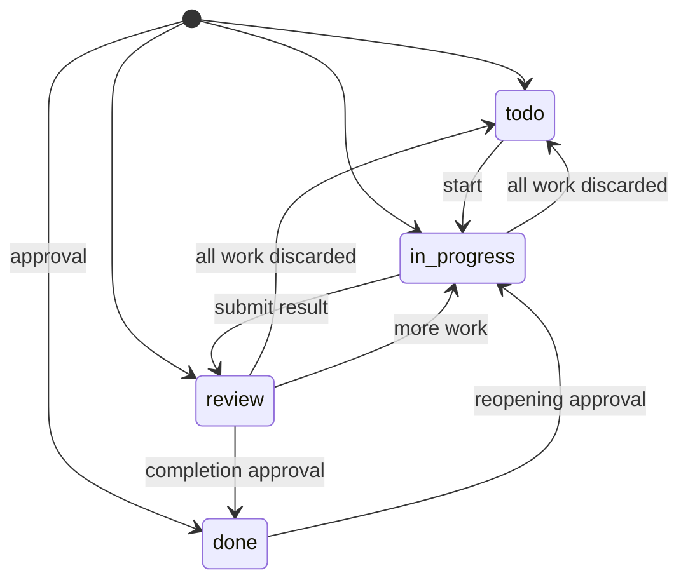

# AAD: Agent-Assisted Development

[](aad.md)
[](https://github.com/jveres/aad/actions/workflows/pages.yml)

AAD is a working process for software projects where **people and AI agents
work together through shared knowledge and shared tasks**.

A *worker* is a person or an agent. Each worker must be able to find the rules,
understand the task, and continue the work **without earlier conversations**.
People remain responsible for project policies, access, and approval decisions.

- **Spec:** [`aad.md`](aad.md) (version 2.3.0) and record schemas in [`wiki/schemas/`](wiki/schemas/README.md). These are the accepted sources. The README and the site summarize them.
- **Site:** <https://jveres.github.io/aad/>. An interactive introduction with a state machine, a task linter, and a publication classifier.

---

## Contents

- [Adopt AAD in a project](#adopt-aad-in-a-project)
- [The method in brief](#the-method-in-brief)
  - [Core rules](#core-rules)
  - [Repository layout](#repository-layout)
  - [Tasks](#tasks)
  - [Task lifecycle](#task-lifecycle)
  - [Publication](#publication)
  - [Development activities](#development-activities)
  - [Startup and guide reading](#startup-and-guide-reading)
  - [Guide versioning](#guide-versioning)
- [The website](#the-website)
- [Development](#development)
- [Releasing a new AAD version](#releasing-a-new-aad-version)

---

## Adopt AAD in a project

Open an agent in the project folder and paste this prompt. The folder can be
empty or an existing project. You do not need to download anything first.

```text
Set up AAD (Agent-Assisted Development) 2.3.0 in this project folder. The folder can be empty or an existing project.

1. Download the guide and schemas: mkdir -p wiki/schemas && curl -fsSL https://raw.githubusercontent.com/jveres/aad/v2.3.0/aad.md -o wiki/aad.md && for f in README.md task.schema.md exploration.schema.md decision.schema.md; do curl -fsSL "https://raw.githubusercontent.com/jveres/aad/v2.3.0/wiki/schemas/$f" -o "wiki/schemas/$f"; done
   If wiki/aad.md already exists, compare the versions and ask me before you replace it. Read the full guide. §13 Adoption is the checklist; §9 has the AGENTS.md template.
2. Examine the folder: Git repository, remote and default branch, README, AGENTS.md, CLAUDE.md and other agent instruction files, docs, build and test commands, CI. If there is no Git repository, ask me before you run git init. Do not overwrite or move existing files. Extend them, or link to existing equivalents.
3. Create or extend AGENTS.md, wiki/README.md (linking wiki/schemas/README.md and the knowledge collections), and wiki/engineering.md. Make sure that CLAUDE.md contains the line @AGENTS.md. Fill in what you can find in the project. Ask me, in one short list with your recommended defaults, the decisions that only people can make: accepted baseline, task ID allocation, publication methods, reviewers, approval authority, sensitive actions, ASD-STE100 issue. Do not leave placeholders. Record each unresolved item under "Adoption gaps".
4. Create other documents only when they have real content now. Ask me for one small, real first task and create it in wiki/tasks/ using wiki/schemas/task.schema.md.
5. Show me the changes and the 14 adoption steps, each marked done or gap. Do not commit or push without my approval.
6. Tell me how to test the setup: a new agent session without this conversation does the next activity of the first task, and a second agent reviews the result.
```

The agent stops for your decisions and approvals. Then it gives you the
trial to run (steps 11–14 below). Those steps need fresh agent sessions.

To get only the guide and schemas, without the agent setup, download a pinned
copy. The tag matches the AAD version:

```sh
mkdir -p wiki/schemas wiki/tasks && \
  curl -fsSL https://raw.githubusercontent.com/jveres/aad/v2.3.0/aad.md -o wiki/aad.md && \
  for f in README.md task.schema.md exploration.schema.md decision.schema.md; do \
    curl -fsSL "https://raw.githubusercontent.com/jveres/aad/v2.3.0/wiki/schemas/$f" -o "wiki/schemas/$f"; \
  done
```

The adoption steps in [`aad.md` §13](aad.md#13-adoption):

1. Add the guide as `wiki/aad.md` and install the record schemas under `wiki/schemas/`. Reuse equivalent project locations where appropriate, updating all links consistently.
2. Create `AGENTS.md` (template in [§9](aad.md#9-agent-entry-point)) and `wiki/README.md`, linking `wiki/schemas/README.md` and the knowledge collections.
3. Document setup, checks, approvals, and completion rules in `wiki/engineering.md`.
4. Define task ID allocation.
5. Name the accepted baseline and the combined and task-only publication methods.
6. Configure trusted task checks for both publication paths. Record any gaps.
7. Record essential requirements and decisions.
8. Record approved skills and tools.
9. Record the selected ASD-STE100 issue.
10. Create the first task using `wiki/schemas/task.schema.md`.
11. Ask an agent without earlier context to do the next activity.
12. Publish coordination state promptly. Keep completion separate.
13. Ask another agent to continue or review the result.
14. Correct the gaps found in the trial.

A template with unresolved placeholders does not establish conformance. The
spec includes a minimal `engineering.md` outline and a table of
[adoption decision cases](aad.md#adoption-decision-cases) to test your setup against.

## The method in brief

This section is a summary. If it disagrees with [`aad.md`](aad.md), the spec wins.

### Core rules

1. Keep one accepted source for each rule or decision.
2. Link to existing information. Do not copy it.
3. Give agents a short starting point.
4. Read detailed information when the task needs it.
5. Connect work to a clear problem or intended outcome.
6. Separate facts, assumptions, recommendations, and accepted decisions.
7. Support findings with evidence.
8. Select checks based on the work and its risks.
9. Where tools can enforce a rule, use those tools.
10. Review results before you accept them.
11. Keep shared tasks current.
12. Search for suitable existing tools before you create new ones.

The spec's [Working Reference](aad.md#working-reference) maps each common
activity to its record and to the rules for approval and publication.

### Repository layout

The accepted baseline is the current default branch of the shared repository.
A local-only project names a local branch for this role and reports that the
state is not shared.

```text
project/
├── AGENTS.md                   # starting instructions for agents
├── src/  tests/  scripts/
└── wiki/
    ├── README.md               # main knowledge index
    ├── aad.md                  # accepted working process (the only versioned doc)
    ├── schemas/                # record-structure schemas + collection index
    │   ├── README.md
    │   ├── task.schema.md
    │   ├── exploration.schema.md
    │   └── decision.schema.md
    ├── requirements.md         # accepted behavior and quality requirements
    ├── architecture.md         # system boundaries and technology roles
    ├── engineering.md          # setup, checks, approvals, publication, tools
    ├── decisions/              # ADRs: proposed → accepted | rejected | superseded
    ├── experiments/            # exploration records and evidence
    ├── checkpoints/            # current-state summaries and recovery maps
    ├── proposals/              # proposed process changes
    ├── sources/                # source ledgers and provenance
    └── tasks/                  # one file per task; filename = stable ID
```

Requirements go in policy, mechanics go in configuration, and reasons go in
decision records. Dedicated Markdown schemas in [`wiki/schemas/`](wiki/schemas/README.md)
define record structure ([`task.schema.md`](wiki/schemas/task.schema.md),
[`exploration.schema.md`](wiki/schemas/exploration.schema.md),
[`decision.schema.md`](wiki/schemas/decision.schema.md)), while [`aad.md`](aad.md)
and `wiki/engineering.md` govern lifecycle, approvals, and publication. A written
rule or Markdown schema does not enforce itself.

`wiki/README.md` is the main knowledge index: it links to accepted guidance and
knowledge collections with a short statement of what each contains or when to
use it. Add a collection `README.md` (such as `wiki/schemas/README.md`) when a
collection becomes difficult to navigate from the main index. Before creating a
knowledge document, read the wiki index, any relevant collection index, and
search relevant repository files; update an existing accepted source when it
already fits. Update affected indexes and references in the same change, and
link to the task collection or board rather than listing every task in the main
index.

Agents keep private notes and plans in their own tools. Remembered project
facts are hints: compare them with current sources before you act on them.

### Tasks

A task is a unit of work with a clear goal ([`wiki/schemas/task.schema.md`](wiki/schemas/task.schema.md)). It has a YAML header for tools and
a Markdown body for people:

```markdown
---
title: Add filtering to the payments table
status: in_progress
aad_version: 2.3.0
---

## Goal
Help support staff find failed payments without engineering help. …

## State
Filtering is implemented on branch `T-014-payment-filters`. Unit tests pass. …

## Next
Test keyboard navigation.

## References
- [UI requirements](../requirements/ui.md)
```

| Field / section | Meaning |
|---|---|
| `title`, `status`, `aad_version` | Required header fields |
| `owner`, `blocked_by` | Optional: who acts next; current unfinished blockers |
| `Goal` | Intended result, benefit, and success criteria |
| `State` | Progress, evidence, blockers, unresolved questions |
| `Next` | Next action. `None` only when `done` |
| `References` | Relevant sources and work results |

`aad_version` records the guide that the publishing worker read and used. It
does not prove what a later worker knows.

### Task lifecycle



The transition table in the spec is authoritative. **An unlisted transition is
invalid, and no approval can grant it.** For example, `in_progress → done` is
always rejected. Paused or blocked work with retained progress stays
`in_progress`; `in_progress → todo` is only for discarded work.

*Acceptance* means completion approval by the authorized decision-maker. A
review recommendation is not acceptance. Before starting unrelated implementation, resolve tasks that
wait for acceptance (accept, request changes, or record an explicit deferral).
A commit, push, or merge makes work available. It does not grant acceptance.

### Publication

| Path | Allowed content |
|---|---|
| Combined | Implementation + **routine** task changes (progress, fields, `in_progress → review`, creation in `todo`/`in_progress`/`review`). Task edits go in their own commit. |
| Task-only | Only task records. Required for completion, creation in `done`, reopening, cancellation, and goal changes, after approval. |

A pull request is classified by its most restrictive change:
**invalid → unclassified → approval-sensitive → routine**. Trusted task checks
and applicable record schemas load from the current target branch, not from the
candidate. A candidate cannot use its own rule or schema changes to pass
validation; publish schema or validator changes before record edits that depend
on them. A task ID is stable: a rename that changes an allocated ID is rejected.
An approved behavior change can ship with its implementation and tests;
task-goal edits stay task-only.

### Development activities

Discovery → Exploration → Implementation → Review → Delivery → Operation, plus
**Project Checkpoint** to reduce the live tree while Git keeps the history. The
task goal defines the result. `Next` names the activity. Reusable exploration
findings follow [`wiki/schemas/exploration.schema.md`](wiki/schemas/exploration.schema.md)
and architectural decisions follow [`wiki/schemas/decision.schema.md`](wiki/schemas/decision.schema.md)
(neither requires YAML or invalidates existing records that use different
headings). Different agents can do different activities in the same task. Before
each push, do an **audit**: compare against the latest baseline, find stale
guidance, and record evidence and omitted checks.

### Startup and guide reading

Each worker starts from `AGENTS.md`, fetches the accepted baseline, and
establishes which guide revision it read earlier. Targeted schema loading
improves record creation and checks, but does not waive full-guide startup
reading:

| Known baseline vs current guide | Required reading |
|---|---|
| Unknown or uncertain | Full guide |
| Major or minor changed | Full guide |
| Only patch changed | Complete diff (full guide if diff unavailable) |
| Same version, different content | That diff |

### Guide versioning

`MAJOR.MINOR.PATCH` by compatibility impact:

- **Major:** breaks the record format or process contract (migration, states/transitions, approval gates, publication model).
- **Minor:** compatible additions, including new prospective obligations.
- **Patch:** wording, examples, formatting, links. No change in meaning.

## The website

`public/` is a static site with no runtime dependencies and no external requests.
It fetches `aad.md` next to itself, so the version and the latest change come
from the spec (core rule 1).

| Section | What you can do |
|---|---|
| §02 Repository | Explore the layout, the accepted source, and an example file for each path, including `wiki/schemas/` (spec and schema examples are checked against `aad.md` and `wiki/schemas/*.md`) |
| §03 Lifecycle | Drive a task through the state machine; see routine, approval-gated, and rejected transitions |
| §04 Linter | Edit a task file and get live diagnostics against `wiki/schemas/task.schema.md` and `wiki/aad.md` (header, sections, `Next`, transitions, dependencies, version) |
| §05 Publication | Compose a pull request and see its classification and publication path |
| §06 Activities | Step through each development activity |
| §01 Rules | Core rules and the Working Reference table |
| §07 Startup | Compute the guide-reading rule and the next version bump |
| §08 Adoption | Track the 14 adoption steps (stored locally) and search the decision cases |

The linter checks structure only. Semantic scope review still applies, as the spec states.

## Development

Requirements: Node.js 22 or later.

| Tool | Version | Role |
|---|---|---|
| [TypeScript](https://www.typescriptlang.org/) | 7.0.2 (native compiler) | Type checking and compiling `src/` to ES modules in `public/js/` |
| [Biome](https://biomejs.dev/) | 2.5.15 | Formatting and linting for TS, JS, CSS, HTML, and JSON |

```sh
npm ci
npm run serve        # build, then serve public/ at http://localhost:8080
npm run check        # version consistency + biome + tsc --noEmit
npm run format       # apply biome fixes and formatting
npm run build        # tsc → public/js, copy aad.md and wiki/schemas/ → public/, verify samples
```

```text
aad.md                    # the spec (accepted source)
wiki/schemas/             # record schemas: README, task, exploration, decision
public/                   # static site: index.html, styles.css, favicon.svg
src/
  model.ts                # states, transition and creation tables, classification order
  task-lint.ts            # task file checks
  publication.ts          # pull request classification
  versioning.ts           # reading rule, version bump
  content.ts              # page content condensed from aad.md
  samples.ts              # example file for each §02 path
  dom.ts                  # small DOM helpers (no innerHTML)
  main.ts                 # page wiring
scripts/
  build.js  check-version.js  check-samples.js  serve.js
.github/workflows/pages.yml  # check, build, deploy to GitHub Pages
```

CI runs `npm run check` and `npm run build` on every push and pull request.
Pushes to `main` deploy `public/` to GitHub Pages. Tag builds also verify that
the tag matches the spec version.

## Releasing a new AAD version

1. Update `aad.md`: the `version` in the header, and the **Latest Change** section, which must start with the new version.
2. Set the same version in `package.json` and in the fallback `guideVersion` in `src/main.ts`.
3. Update the version in this README (badge and adopt command).
4. Run `npm run check`. It fails if the versions disagree.
5. Commit, then tag and push:

   ```sh
   git tag -a vX.Y.Z -m "AAD X.Y.Z"
   git push origin main --tags
   ```

The version number does not approve a change. Spec changes follow the review
rules in [`aad.md` §8](aad.md#8-guide-version-and-document-changes).
